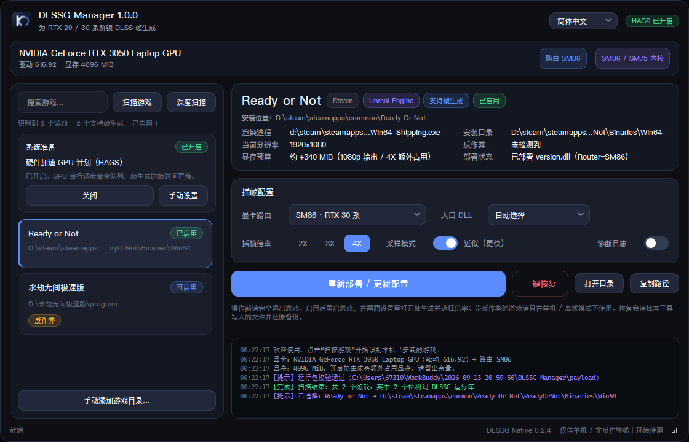
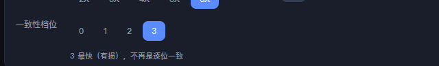
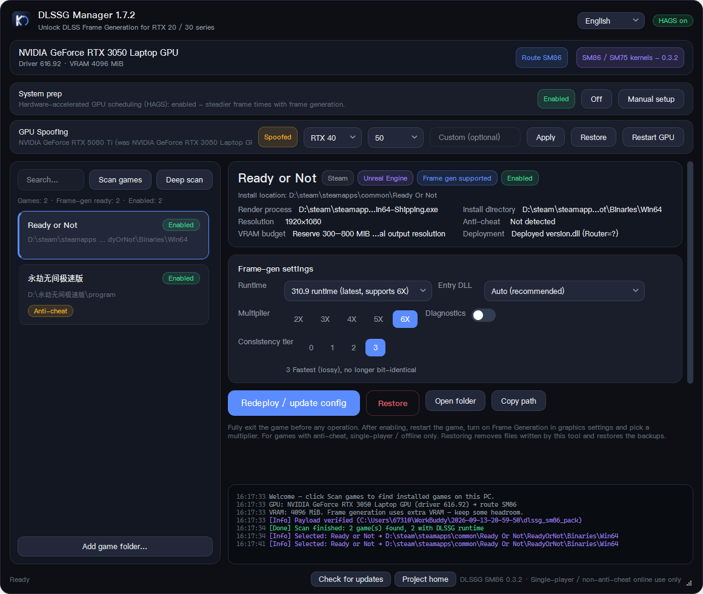
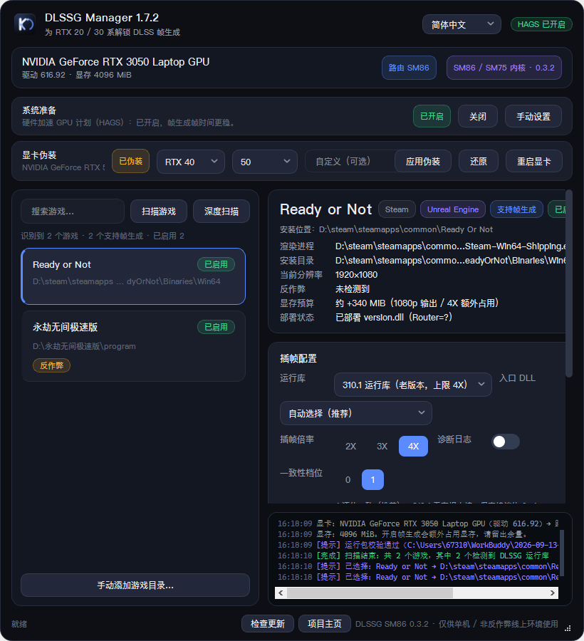

<div align="center">

# DLSSG Manager

**为 RTX 20 / 30 系显卡解锁 DLSS 帧生成的一键式图形工具**

**简体中文** · [繁體中文](docs/README.zh-TW.md) · [English](docs/README.en.md)

[](#下载与安装)
[](#下载与安装)
[](#致谢与出处)

</div>

---

## 致谢与出处

> **本项目的核心能力完全来自上游项目 [dlssg_for_sm86](https://github.com/sdli1995/dlssg_for_sm86)，由 [sdli1995](https://github.com/sdli1995) 开发维护。**
>
> 正是上游作者对 DLSSG Native（`version.dll` 代理 + SM86 / SM75 内核路由）的逆向与封装，
> 才让 RTX 20 / 30 系用户用上 DLSS Frame Generation。本工具只是站在这个肩膀上，
> 把「找游戏目录、挑入口 DLL、写配置、管备份」这些繁琐步骤做成了图形界面。
>
> **向原作者致以敬意与感谢。** 上游二进制（payload/ 下的 DLL）随本工具原样分发，
> 未做任何修改，版权归原作者所有；如上游项目对你有帮助，请先去给上游一个 Star。

### 关于更新

本工具**会跟随上游项目 [dlssg_for_sm86](https://github.com/sdli1995/dlssg_for_sm86) 的更新**：

- 上游发布新版本（新的推理内核、兼容性修复等）时，
  本仓库会同步更新 `payload/` 内的运行库文件并发布新的 Release；
- 界面与识别逻辑也会跟随上游的能力边界调整（例如新显卡支持、生成帧上限变化、
  一致性档位这类语义变化）；
- 因此**建议使用最新 Release**，而不是停留在旧版本 —— 上游的兼容性修复
  往往直接决定某些游戏能不能正常开起来。

如果你发现上游已更新而本工具尚未跟进，欢迎提 issue 提醒。

各版本改动汇总见 [CHANGELOG.md](CHANGELOG.md)。

DLSS 与 DLSS Frame Generation 是 NVIDIA Corporation 的商标与专有技术。上游 0.4.1 运行包按官方发布原样分发，
包含 NVIDIA 与 Intel 第三方二进制；授权和来源见 `payload/THIRD_PARTY_NOTICES.txt`，本工具不修改这些文件。

### 为什么做这个工具

和我一起打游戏的好友里，好几个还在用 RTX 30 系、20 系显卡。他们看到别人开帧生成，
抱怨自己的卡"没有生成"。我把原作者的项目分享给他们——GitHub 勉强访问得上，可打开
之后盯着页面看了半天，还是不知道从哪里下手。于是我把以前的老电脑翻出来，做了这个
图形工具：现在他们点两下按钮，帧生成就开起来了。

这个工具是写给他们的，也写给每一个和当时的他们一样的你。

---

## 界面预览

<div align="center">



<sub>主界面 —— 左侧游戏列表，右侧识别结果与插帧配置</sub>

</div>

<details>
<summary><b>更多截图</b>（一致性档位 / 英文界面 / 窄窗口）</summary>

<br>

**一致性档位（上游 0.3.2 新增）** —— 可选 0–3 四档：

<div align="center">

</div>

**English**：

<div align="center">

</div>

**窄窗口（820×900）** —— 配置行自动换行，内容可滚动，不裁剪不重叠：

<div align="center">

</div>

</details>

---

## 这是什么

DLSSG Manager 自动扫描本机已安装的 D3D12 游戏，定位真正的渲染 EXE，
一键部署 / 一键恢复上游 DLSSG 代理与配置，让 RTX 20（SM75）/ RTX 30（SM86）
显卡在支持 DLSS 的游戏中开启**帧生成**。

### 特性一览

- **自动识别游戏**：Steam / Epic / GOG / Ubisoft 平台库 + 按盘符深度扫描 + 手动添加目录，
  自动穿透启动器定位真正渲染 EXE，并识别 Unreal / Unity 引擎
- **启动与扫描更顺畅**：启动动画复用静态背景，显卡探测和运行包校验在后台完成；游戏目录最多 4 路并行分析，结果顺序保持稳定
- **一键启用 / 一键恢复**：入口 DLL 自动避让（version → winmm → dbghelp → dinput8），
  绝不覆盖他人物件；部署带 SHA256 校验与自动备份，恢复还原如初
- **一致性档位（0–3）**：直接决定「生成画面能偏离官方运行库多远」——
  `0` 原厂内核（最保守）、`1` 全部逐位一致的加速（默认，**画面与官方完全相同**）、
  `2` 再加有损图像内核、`3` 全部有损加速（最快）
- **两种插帧引擎**：DLSS-G 默认；可选 XeSS-FG 多帧生成（2X–4X）
- **DLSS 超分选项**：M/L INT8 或 FP16 内核，默认关闭，RTX 20 / 30 系可用
- **可解释的配置项**：鼠标悬停可查看 DLSS-G A/B/C 预设及每个 DLSS 超分模式的说明；扫描误报可从卡片右键移除并忽略（不会删除游戏文件）
- **配套运行库**：使用上游 0.4.1 的 310.9.16；DLSS-G 最高 6X，XeSS-FG 最高 4X，实际倍率还受游戏自身限制
- **兼容运行库回退**：新运行库让游戏闪退时，可切到 310.9 或 310.1 兼容运行库（上游 0.3.5）重新部署；界面会自动收起 0.4.x 专属选项，并跟着调整倍率 / 档位上限
- **分辨率感知**：读取 UE / Unity 配置估算当前分辨率，给出显存增量预算
- **反作弊提示**：检测到反作弊系统时仅作提示，不影响任何功能使用
- **系统准备**：硬件加速 GPU 计划（HAGS）检测 + 一键开关 + 跳转系统设置，帧时间更稳
- **入口分层照搬上游**：工具类代理优先（`version` → `winmm` → `dbghelp` → `dinput8`，自动选择只走这组）；
  `dxgi` / `d3d12` 属 D3D12 渲染热路径、加载顺序敏感，列为高风险并由你手动指定，**二者互斥**（部署时强制校验）
- **显卡伪装**：把显卡名称伪装成 RTX 40 / 50 系（50 / 60 / 70 / 80 / 90 及 Ti 档位），
  绕过部分游戏按型号判断的限制；支持自定义型号，随时一键还原。
  写入系统「设备实例」名称（DXGI / WMI 读取处）并提供**一键重启显卡**使改动立即生效
- **更新检测**：启动时静默检查新版本（6 小时内只查一次），发现新版本时标题栏出现可点击徽标；
  也可随时点页脚「检查更新」。**只读公开 API，不上传任何本机数据**
- **多语言**：简体中文 / 繁體中文 / English，跟随系统自动选择；
  社区可在 `lang/` 目录添加语言文件，无需重新打包
- **精致界面**：无边框圆角暗色 UI、KANNI 载入动画、macOS 风格三色窗口按钮、像素级文本省略

---

## 下载与安装

前往 [**Releases**](../../releases) 页面下载对应版本（当前 **v1.9.6**）：

| 版本 | 文件 | 适合人群 |
|---|---|---|
| **免安装便携版** | `DLSSG_Manager_1.9.6_portable_x64.zip` | 想即解压即用、绿色不写注册表 |
| **标准安装版** | `DLSSG_Manager_1.9.6_setup_x64.exe` | 想要安装向导、开始菜单/桌面快捷方式与完整卸载 |

**便携版**：解压到任意目录，双击 `DLSSG Manager.exe` 即可。
**安装版**：双击 setup，按向导选择目录安装；卸载请到「设置 → 应用 → 安装的应用」或
开始菜单里的 Uninstall，会一并清理快捷方式与注册表条目。

> 两个版本功能完全一致，都自带 `payload/` 运行库与多语言文件，**不需要安装
> Python / CUDA / 任何运行库**（2–4 秒首次解压启动属正常现象）。

---

## 使用说明

1. 启动后软件自动扫描本机游戏（也可点「深度扫描」按盘符全盘反查，或「手动添加游戏目录…」）；
2. 左侧选中游戏，右侧确认识别结果（渲染进程、分辨率、反作弊提示、部署状态）；
3. 选择插帧引擎、倍率与一致性档位；DLSS-G 预设和超分模式可按需调整，默认超分关闭；
4. 点击 **「一键启用插帧」**，完全退出游戏后重新启动；
5. 在游戏画面设置里打开帧生成并选择倍率（DLSS-G 最高 6X，XeSS-FG 最高 4X）；
6. 想还原时回到本工具点 **「一键恢复」**，游戏目录会清理干净。

更多细节（显存预算、INI 参数、排查方法、能力边界）见 [docs/使用说明.txt](docs/使用说明.txt)。

### 系统要求

| 项目 | 要求 |
|---|---|
| 系统 | Windows 10 2004+（build 19041）/ Windows 11，x64 |
| 显卡 | NVIDIA RTX 20 / 30 系（SM75 / SM86） |
| 驱动 | NVIDIA R580 或更新版本（上游 0.4.x 的硬性要求） |
| 游戏 | D3D12 且内置 DLSS 运行库（工具会自动判断并提示） |

---

## 多语言

界面语言在**标题栏右上角下拉框**切换（重启程序生效），首次启动跟随系统语言。
新增语言：在程序目录新建 `lang/<语言代码>.json`（UTF-8，键为简体中文原文，值为译文，
另加 `"_meta": {"name": "语言原生名"}`），参照自带 `lang/en_US.json`，重启即可。
命令行也可用 `--lang en_US` 临时指定。

---

## 从源码构建

```bat
git clone https://github.com/kanniganfan/dlssg-manager.git
cd dlssg-manager
python scripts\import_upstream_release.py path\to\dlssg-release-0.4.1-x64.zip
scripts\build_windows.bat
python scripts\build_release.py --portable-only
```

先用 `scripts/import_upstream_release.py` 校验官方 0.4.1 发布包 SHA-256 并导入 `payload/`，
再构建程序和发行包。发布物包含完整运行包、来源许可和第三方声明。

目录结构：

```
src/       Python 源码（core 逻辑内核 / ui 界面 / i18n 引擎 / main 入口）
lang/      界面语言文件（JSON，可直接编辑或新增语言）
assets/    图标资源
docs/      使用说明与界面截图
scripts/   构建、校验与维护脚本
```

`scripts/` 里的自检脚本（提交前会跑）：

| 脚本 | 作用 |
|---|---|
| `check_tuple_arity.py` | 校验 `ENTRIES` / `RUNTIMES` 等常量表的元组长度一致 |
| `check_i18n_keys.py` | 对比 `src/` 里 `tr()` 用到的键与词典，列出缺失 / 多余 |
| `check_upstream_sync.py` | 检查上游是否有新版本，并用 git blob SHA-1 验证本地 payload 与上游 HEAD 是否逐字节一致（退出码 0=已同步 / 1=需同步） |
| `smoke_ui.py` | 离屏 UI 冒烟：档位联动、`FlowRow` 换行、toast 定位、按钮不裁字、更新检测三态 |
| `e2e_deploy.py` | 临时目录里跑 部署 → 读回 → 恢复 闭环 |
| `scan_parallel_check.py` | 临时合成目录检查并行扫描的结果顺序、去重和耗时 |
| `build_release.py` | 打包便携版 zip + NSIS 安装器 |

---

## 能力边界与免责声明

- 仅支持 **Windows x64 + D3D12** 游戏；Vulkan 暂不支持
- 帧倍率上限取决于引擎与游戏：DLSS-G 最高 6X，XeSS-FG 最高 4X，多数游戏受内置插件上限约束
- XeSS-FG 和超分模式为可选项；效果和性能依赖游戏、显卡及分辨率，默认使用 DLSS-G 且关闭超分
- 上游 0.4.1 的实卡与离线测试范围见 `payload/README.md`，不同引擎、显卡与游戏的结果并不相同
- **反作弊提示**：检测到反作弊系统时仅作提醒；请自觉只在单机 / 离线 / 实验室环境使用，
  线上模式的使用由用户自行判断与承担
- **更新检测**：启动时静默检查本工具是否有新版本（6 小时内只查一次），
  也可随时点页脚「检查更新」；发现新版本时标题栏出现可点击的版本徽标。
  检查是**只读的 GitHub 公开 API 查询，不上传任何本机数据**，也不发送任何标识信息
- 除上述更新检测外，本工具不联网、不上传任何数据，全部操作在本机完成
- 修改游戏目录前请确认已了解上述内容，使用本工具产生的一切后果由使用者自行承担

---

## 联系方式

- 邮箱：[cylqm@qq.com](mailto:cylqm@qq.com)
- 邮箱：[cao673100060@gmail.com](mailto:cao673100060@gmail.com)

欢迎 issue / PR；语言文件捐赠（任何语种）尤其欢迎。

---

## License

本项目代码以 [MIT License](LICENSE) 发布。
`payload/` 内的上游运行包按官方发布原样随附；各第三方文件保留其原许可，
详情见 `payload/LICENSE.md` 和 `payload/THIRD_PARTY_NOTICES.txt`。DLSS 技术与商标归 NVIDIA Corporation 所有。

---

<div align="center">

**Again, all credits to [sdli1995/dlssg_for_sm86](https://github.com/sdli1995/dlssg_for_sm86)**

</div>
